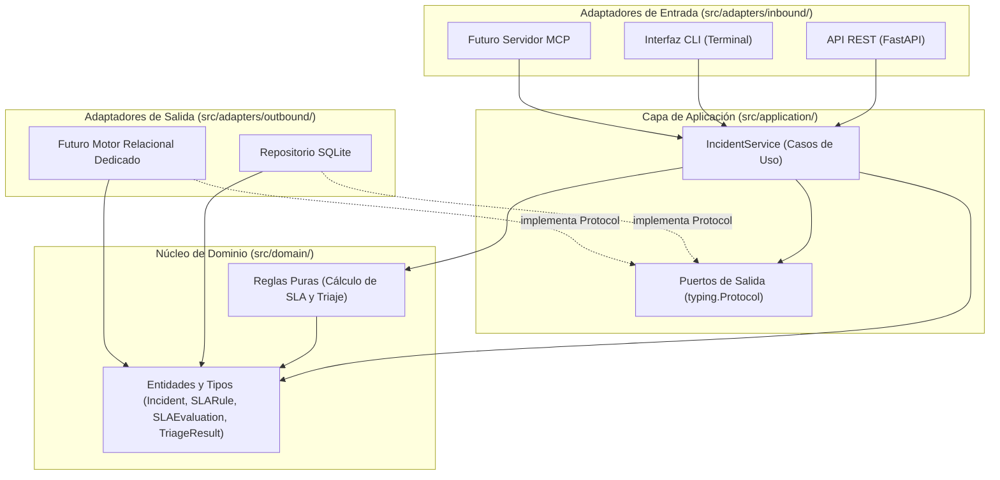

# ADR-003: Adopción de Arquitectura Hexagonal (Puertos y Adaptadores) para IncidentOps

**Estado**: Propuesto
**Fecha**: 2026-11-23
**Autor(es)**: Camilo Andres Rodriguez Salamanca

## 1. Contexto y Problema
Actualmente, IncidentOps opera como un paquete plano en `src/` donde la lógica de negocio pura convive con detalles de infraestructura y ejecución manual:
- `src/models.py` y `src/sla_calculator.py` encapsulan entidades y cálculo determinista de SLA con cero dependencias externas.
- `src/triage_rules.py` contiene las reglas de clasificación y enrutamiento, pero referencia rutas locales de archivos (`data/sample_incidents.json`) para su demostración.
- `src/incident_repository.py` acopla en una misma clase (`IncidentRepository`) la conexión directa a `sqlite3`, la definición del esquema SQL, el sembrado de datos sintéticos, la invocación a `evaluate_sla_status`, la proyección a diccionarios de salida y el arnés de benchmark CLI.

De acuerdo con `docs/ROADMAP.md`, el sistema debe evolucionar para soportar múltiples canales de entrada (interfaz web REST y terminal CLI en H001–H002, además de futura exposición como servidor MCP) y sustituir la persistencia inicial en SQLite por un motor relacional dedicado en contenedores (H004), manteniendo la integridad del ciclo de vida, detección de duplicados y auditoría de SLA (H003).

**Problema estructural**: Es necesario definir **cómo organizar las fronteras entre las reglas de negocio, la orquestación de casos de uso, los canales de entrega y los motores de persistencia** antes de introducir frameworks web, CLIs o bases de datos dedicadas. Cambiar esta topología más adelante implicaría reescribir rutas, servicios y acceso a datos acoplados entre sí.

**Restricciones vigentes**:
- El núcleo de dominio (`Incident`, `SLARule`, `SLAEvaluation`, `TriageResult`, cálculo de SLA y triaje) debe permanecer determinista y libre de frameworks web o drivers de base de datos (Python `>=3.10`, librería estándar).
- La lógica de negocio no debe duplicarse entre REST, CLI y un futuro adaptador MCP.
- Debe ser posible ejecutar y probar las reglas y casos de uso en aislamiento sin levantar un servidor HTTP ni una base de datos real, y reemplazar SQLite por otro motor relacional sin alterar el dominio.

## 2. Opciones Consideradas
1. **Opción A Arquitectura en Capas Tradicional (N-Tier) acoplada a FastAPI y SQLite/ORM**:
   *Ventajas*: Baja fricción inicial para exponer los primeros endpoints en FastAPI; estructura lineal familiar (`routers -> services -> repository/ORM`) con menor cantidad de archivos e interfaces explícitas al arranque.
   *Desventajas*: Tiende a acoplar los casos de uso al ciclo de vida HTTP (dependencias de FastAPI/Pydantic) y al modelo relacional concreto de SQLite/ORM. Reutilizar exactamente los mismos casos de uso desde CLI o un futuro servidor MCP obliga a replicar validaciones o a cargar dependencias web en herramientas de terminal; además, migrar a una base de datos relacional dedicada en H004 o probar reglas sin BD exige mayor esfuerzo de refactorización o *patching*.
2. **Opción B Arquitectura Hexagonal (Puertos y Adaptadores)**:
   *Ventajas*: Aísla el núcleo puro en `src/domain/` y concentra la orquestación de casos de uso en `src/application/` (`IncidentService`) dependiendo exclusivamente de contratos estructurales (`typing.Protocol`). Los canales de entrada (REST, CLI, futuro MCP) residen en `src/adapters/inbound/` y la persistencia intercambiable (SQLite inicial y futuro motor relacional dedicado) reside en `src/adapters/outbound/`, invirtiendo las dependencias hacia el centro. Permite pruebas unitarias deterministas en memoria y evolución independiente de transporte y almacenamiento.
   *Desventajas*: Mayor cantidad de módulos y capas de indirección inicial (definición de puertos `Protocol`, adaptadores y ensamblado/inyección de dependencias en el *composition root*), además de exigir disciplina estricta para no filtrar tipos de frameworks o SQL hacia `domain/` o `application/`.

## 3. Decisión Arquitectónica
Se elige la **Opción B (Arquitectura Hexagonal — Puertos y Adaptadores)**.

IncidentOps tiene como requisito estructural invariante compartir exactamente el mismo comportamiento determinista de triaje, ciclo de vida y auditoría de SLA entre múltiples interfaces heterogéneas (web REST, terminal CLI y futuro MCP) y evolucionar de SQLite hacia una base de datos relacional dedicada en contenedores. La Arquitectura Hexagonal protege la inversión en `src/domain/` (reglas de SLA y triaje sin dependencias externas) y centraliza los casos de uso en `src/application/` mediante `IncidentService` y puertos tipados con `typing.Protocol` (tipado estructural nativo de Python sin necesidad de herencia rígida). De este modo, agregar un nuevo canal de entrada o intercambiar el motor de almacenamiento solo requiere añadir o sustituir adaptadores en `src/adapters/{inbound,outbound}/` y conectarlos en el punto de composición de la aplicación.

## 4. Consecuencias y Trade-offs
**Positivas**:
- **Desacoplamiento transporte-dominio**: REST, CLI y un eventual servidor MCP invocan el mismo `IncidentService`, evitando divergencias en reglas de severidad, duplicados o SLA.
- **Portabilidad de persistencia**: El uso de `typing.Protocol` permite sustituir `SQLite` por un motor relacional dedicado (H004) o por repositorios en memoria para pruebas rápidas sin modificar `src/domain/` ni `src/application/`.
- **Testabilidad determinista**: El dominio y los casos de uso pueden verificarse de forma aislada sin levantar servidores web ni motores de base de datos.
- **Claridad para asistencia con IA**: Fronteras explícitas entre capas reducen el contexto necesario para modificar reglas, contratos o adaptadores de forma independiente.

**Negativas / Trade-offs**:
- **Mayor sobrecarga estructural inicial**: Introduce separación en múltiples paquetes (`domain`, `application`, `adapters/inbound`, `adapters/outbound`), puertos `Protocol` y mapeo explícito entre modelos de dominio y esquemas externos/SQL.
- **Necesidad de un *composition root***: Al no instanciar adaptadores concretos dentro de `IncidentService`, el ensamblado de dependencias debe residir en los puntos de entrada de la aplicación.
- **Gobernanza de fronteras**: Requiere vigilancia continua (revisiones y pruebas de arquitectura) para impedir importaciones inversas desde `domain/` o `application/` hacia `adapters/` o librerías de infraestructura.
