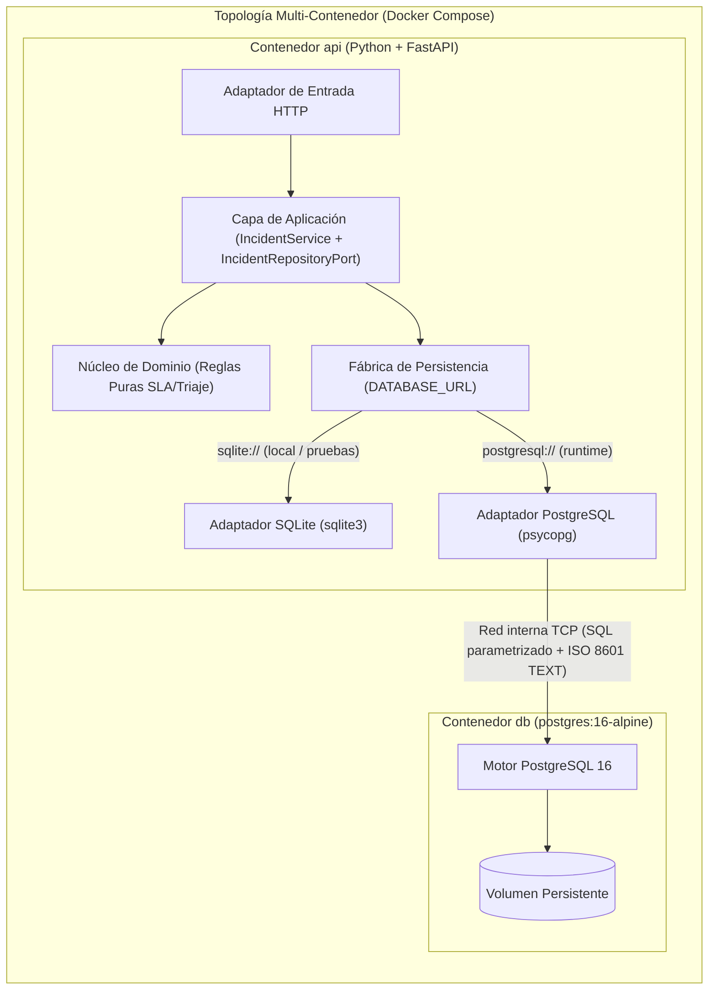

# ADR-004: Persistencia Dual SQLite/PostgreSQL sin ORM y Runtime Multi-Contenedor

**Estado**: Aceptado
**Fecha**: 2026-11-24
**Autor(es)**: Camilo Andres Rodriguez Salamanca
**Reemplaza a**: `ADR-001` *(parcialmente: levanta la restricción de "solo `sqlite3` sin dependencias externas" para permitir el driver `psycopg[binary]` en el adaptador de salida PostgreSQL, manteniendo la prohibición de ORMs pesados y el uso de SQL explícito parametrizado)*

## 1. Contexto y Problema
Hasta ahora, IncidentOps persiste sus incidentes únicamente en SQLite embebido (`sqlite3` de la librería estándar) bajo la restricción inicial de `ADR-001` de evitar dependencias externas de base de datos y ORMs pesados. En paralelo, `ADR-003` estableció una Arquitectura Hexagonal estricta donde la capa de aplicación depende exclusivamente del puerto `IncidentRepositoryPort` y la selección del adaptador de salida ocurre en el *composition root*.

De acuerdo con el hito **H004** de `docs/ROADMAP.md`, el servicio debe evolucionar hacia un entorno reproducible en contenedores con un motor relacional dedicado y verificación real de conectividad operativa, sin degradar la agilidad de ejecución local ni romper las fronteras hexagonales.

**Problema estructural**: Definir **qué estrategia de persistencia relacional y qué topología de runtime en contenedores** adopta IncidentOps para operar con una base de datos dedicada de forma concurrente y reproducible, preservando el núcleo determinista puro y evitando acoplar el dominio o la aplicación a un motor de almacenamiento concreto.

**Restricciones vigentes**:
- El núcleo de dominio (`domain`) y la capa de aplicación (`application`) deben permanecer libres de drivers SQL, frameworks web y detalles de infraestructura (`ADR-003`).
- El cálculo determinista de SLA y manejo de ventanas temporales reside exclusivamente en el dominio (`ADR-002`); la base de datos no debe introducir divergencias implícitas de zona horaria ni redondeo temporal.
- Se mantiene la política de **SQL explícito parametrizado sin ORMs pesados** (`ADR-001`) para evitar escaneos completos en memoria y consultas N+1 ocultas.
- Debe conservarse la capacidad de ejecutar pruebas rápidas y aisladas sin requerir un servidor externo de base de datos, al tiempo que se soporta operación real contra un motor relacional dedicado.

## 2. Opciones Consideradas
1. **Opción A — Mantener SQLite embebido en un único contenedor con volumen persistente**:
   *Ventajas*: Topología mínima de un solo contenedor sin red inter-servicios ni dependencias de drivers externos; latencia nula de red en lecturas; preserva íntegramente `ADR-001`.
   *Desventajas*: El bloqueo de escritura a nivel de archivo (*single-writer lock*) impide escalar múltiples instancias de la API; acopla la persistencia al sistema de archivos del nodo del contenedor; no valida conectividad real por red contra un motor relacional dedicado como requiere H004.
2. **Opción B — Migración exclusiva a PostgreSQL con ORM (SQLAlchemy / SQLModel) en Docker Compose**:
   *Ventajas*: Concurrencia multi-escritor nativa sobre `postgres:16-alpine`; abstracción unificada de dialectos SQL y mapeo de entidades; ecosistema maduro para evolución de esquemas.
   *Desventajas*: Contradice el principio de evitar ORMs pesados (`ADR-001`), introduce sobrecarga de abstracción y riesgo de consultas N+1 implícitas en un modelo acotado; al eliminar el adaptador SQLite, obliga a depender de un motor externo incluso para flujos locales rápidos.
3. **Opción C — Persistencia dual SQLite/PostgreSQL sin ORM (`psycopg[binary]`, selección vía `DATABASE_URL` y timestamps ISO 8601 en `TEXT`) en topología multi-contenedor Docker Compose (`api` + `db` con `postgres:16-alpine`)**:
   *Ventajas*: Aprovecha directamente el puerto `IncidentRepositoryPort` de `ADR-003` manteniendo dos adaptadores intercambiables seleccionados por `DATABASE_URL` en el *composition root*; conserva SQL explícito parametrizado sin ORM; habilita pruebas rápidas en SQLite y ejecución operativa concurrente sobre `postgres:16-alpine` aislado en su propio contenedor; almacenar timestamps ISO 8601 en `TEXT` asegura paridad temporal determinista entre ambos motores sin conversiones implícitas de zona horaria.
   *Desventajas*: Exige levantar parcialmente `ADR-001` para añadir `psycopg[binary]` como dependencia de la capa de adaptadores de salida; requiere mantener paridad manual de DDL y sintaxis de parámetros (`?` vs. `%s`) entre ambos adaptadores; almacenar fechas como `TEXT` renuncia a operadores temporales nativos `TIMESTAMPTZ` en SQL.

## 3. Decisión Arquitectónica
Se elige la **Opción C (Persistencia dual SQLite/PostgreSQL sin ORM en topología multi-contenedor Docker Compose)**.

Esta decisión capitaliza la Arquitectura Hexagonal (`ADR-003`) sin sacrificar el determinismo ni la simplicidad operativa:
- **Persistencia dual sin ORM**: Conviven un adaptador de salida para SQLite (`sqlite3`) y un nuevo adaptador de salida para PostgreSQL basado en **`psycopg[binary]`**, ambos implementando `IncidentRepositoryPort` con SQL explícito y parametrizado. Se reemplaza parcialmente `ADR-001` únicamente en la restricción de "solo `sqlite3` sin dependencias externas", manteniendo vigente la prohibición de ORMs pesados.
- **Selección en el *composition root* vía `DATABASE_URL`**: El ensamblado de dependencias inspecciona `DATABASE_URL` para instanciar el adaptador PostgreSQL (esquemas `postgresql://` / `postgres://`) o SQLite por defecto, manteniendo a la capa de aplicación y al dominio completamente agnósticos al motor.
- **Paridad temporal con timestamps ISO 8601 en `TEXT`**: Todas las marcas de tiempo (`created_at`, `resolved_at` y equivalentes) se persisten como cadenas ISO 8601 en columnas `TEXT` en ambos motores. Dado que toda aritmética de SLA se ejecuta de forma determinista en Python puro dentro del dominio (`ADR-002`), este contrato evita discrepancias de serialización o zonas horarias entre SQLite y PostgreSQL y garantiza ordenamiento lexicográfico consistente.
- **Topología multi-contenedor con Docker Compose**: El runtime se separa en dos servicios independientes conectados por una red interna privada: `api` (servidor de aplicación con adaptador HTTP) y `db` (`postgres:16-alpine` con volumen persistente y verificación de salud), desacoplando el ciclo de vida del proceso de aplicación del motor de datos.

## 4. Consecuencias y Trade-offs
**Positivas**:
- **Concurrencia y reproducibilidad operativa**: Separar `api` y `db` (`postgres:16-alpine`) elimina el cuello de botella de escritura única de SQLite y permite validar conectividad y salud real contra un motor relacional dedicado en un entorno reproducible.
- **Portabilidad real verificada**: Confirma en la práctica el valor de `ADR-003`, ya que el cambio de motor ocurre exclusivamente en la capa de adaptadores de salida y en la variable `DATABASE_URL`, sin modificar `domain` ni `application`.
- **Paridad determinista entre entornos**: El formato ISO 8601 en `TEXT` evita desviaciones silenciosas entre pruebas locales en SQLite y ejecución en contenedores con PostgreSQL.
- **Control total sobre el rendimiento SQL**: Preservar SQL explícito parametrizado sin ORM mantiene previsibles las consultas y evita degradaciones N+1.

**Negativas / Trade-offs**:
- **Dependencia externa de runtime**: Incorporar `psycopg[binary]` amplía la superficie de dependencias del proyecto y revoca parcialmente la restricción de cero drivers externos de `ADR-001`.
- **Mantenimiento dual de adaptadores**: Cualquier cambio de esquema o consulta en `IncidentRepositoryPort` debe mantenerse sincronizado manualmente entre el adaptador SQLite y el adaptador PostgreSQL (incluyendo diferencias de placeholders y DDL).
- **Menor expresividad temporal en SQL**: Persistir timestamps como `TEXT` impide delegar cálculos nativos de intervalos `TIMESTAMPTZ` al motor PostgreSQL; esta limitación es aceptable mientras toda lógica temporal permanezca centralizada en el dominio.
- **Mayor complejidad operativa local**: Ejecutar el stack completo requiere disponibilidad de un runtime de contenedores y gestión de red, variables de entorno y ciclo de vida de volúmenes entre `api` y `db`.
